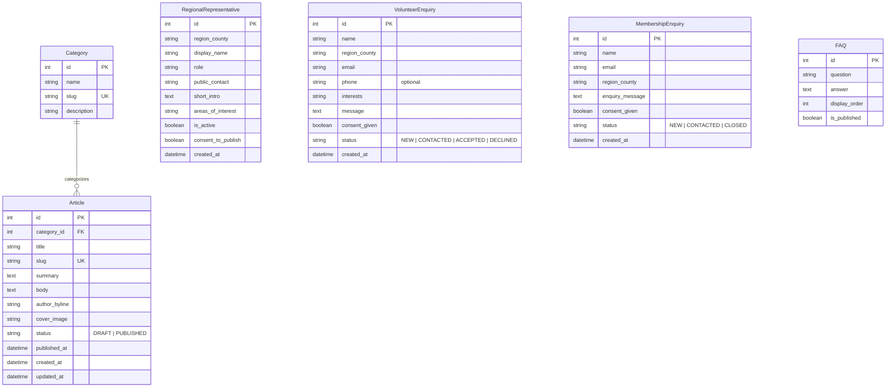

# Content Model & Data Dictionary (Student B — Public Website)

## 1. Overview & Boundaries with Student A
Student B owns the public-facing content, regional representative directory, and public enquiry forms.
- **No duplicate User or Membership models:** In accordance with Section 6, public visitors submit enquiries without creating an account.
- **Role checks:** Staff/Editor permissions rely on Django's standard auth/roles managed in coordination with Student A.

---

## 2. Entity-Relationship Diagram (Mermaid)

---

## 3. Data Dictionary & Validation Rules

### 3.1 `Category`
| Field | Type | Required | Notes |
|---|---|---|---|
| `name` | `CharField(100)` | Yes | Category display name (e.g., News, Conservation, Events). |
| `slug` | `SlugField(120)` | Yes | Unique URL-safe identifier for filtering (`/news/category/<slug>/`). |
| `description` | `TextField` | No | Optional short description of the category. |

### 3.2 `Article`
| Field | Type | Required | Notes |
|---|---|---|---|
| `title` | `CharField(200)` | Yes | Used for H1 and SEO `<title>`. |
| `slug` | `SlugField(220)` | Yes | Unique clean URL (`/news/<slug>/`). |
| `summary` | `TextField(500)` | Yes | Short teaser for list cards and Open Graph description. |
| `body` | `TextField` | Yes | Main article content. |
| `author_byline` | `CharField(120)` | Yes | Display name of the author/editor. |
| `category` | `ForeignKey(Category)` | Yes | `on_delete=PROTECT` to prevent accidental deletion of categories in use. |
| `cover_image` | `ImageField / URLField` | No | Optional cover image. |
| `status` | `CharField(20)` | Yes | `DRAFT` (default) or `PUBLISHED`. Unpublished articles return 404 to anonymous users. |
| `published_at` | `DateTimeField` | No | Set when status becomes `PUBLISHED`. |

### 3.3 `RegionalRepresentative`
| Field | Type | Required | Notes |
|---|---|---|---|
| `region_county` | `CharField(100)` | Yes | Region or county name for filtering/grouping. |
| `display_name` | `CharField(120)` | Yes | Representative's name (synthetic data in development). |
| `role` | `CharField(100)` | Yes | E.g., County Coordinator, Youth Mentor. |
| `public_contact` | `CharField(200)` | Yes | Approved public email or phone. |
| `short_intro` | `TextField(500)` | Yes | Brief biography/introduction. |
| `areas_of_interest` | `CharField(250)` | Yes | E.g., Habitat restoration, New member guidance. |
| `is_active` | `BooleanField` | Yes | Only `is_active=True` and `consent_to_publish=True` are shown publicly. |
| `consent_to_publish` | `BooleanField` | Yes | Explicit permission flag as required by Section 2. |

### 3.4 `VolunteerEnquiry` (Private — Staff Only)
| Field | Type | Required | Notes |
|---|---|---|---|
| `name` | `CharField(120)` | Yes | Applicant's full name. |
| `region_county` | `CharField(100)` | Yes | Region/county of interest. |
| `email` | `EmailField` | Yes | Validated email address. |
| `phone` | `CharField(30)` | No | Optional phone number. |
| `interests` | `CharField(250)` | Yes | Areas where the visitor wants to help. |
| `message` | `TextField(1000)` | Yes | Short introduction/motivation. |
| `consent_given` | `BooleanField` | Yes | Must be `True` to submit. |
| `status` | `CharField(20)` | Yes | `NEW` (default), `CONTACTED`, `ACCEPTED`, `DECLINED`. |

### 3.5 `MembershipEnquiry` (Private — Staff Only)
| Field | Type | Required | Notes |
|---|---|---|---|
| `name` | `CharField(120)` | Yes | Visitor name. |
| `email` | `EmailField` | Yes | Visitor email. |
| `region_county` | `CharField(100)` | Yes | Visitor region/county. |
| `enquiry_message` | `TextField(1000)` | Yes | Question before joining. |
| `consent_given` | `BooleanField` | Yes | Must be `True` to submit. |
| `status` | `CharField(20)` | Yes | `NEW` (default), `CONTACTED`, `CLOSED`. |

### 3.6 `FAQ`
| Field | Type | Required | Notes |
|---|---|---|---|
| `question` | `CharField(250)` | Yes | Frequently asked question title. |
| `answer` | `TextField` | Yes | Answer text displayed on the FAQ page. |
| `display_order` | `PositiveIntegerField` | Yes | Controls sorting order on the public page. |
| `is_published` | `BooleanField` | Yes | Allows hiding draft FAQ entries. |