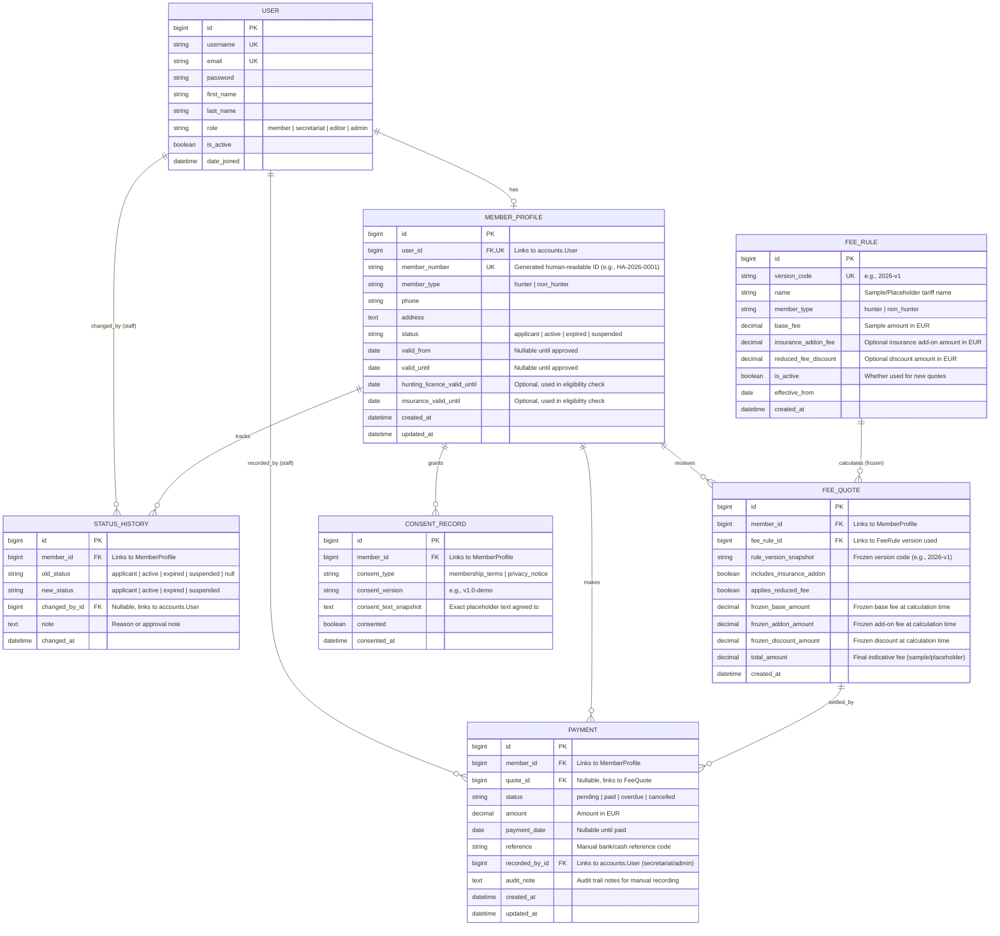

# Membership & Member Portal Data Model (Student A Scope)

This document defines the Entity-Relationship (ER) model and data dictionary for the `membership` module owned by **Student A**. It strictly follows **Section 2 (In scope — MUST deliver)** and **Section 6 (Coordination with Student B)** of the assignment specification, avoiding over-collection of personal data and maintaining a single unified authentication model (`accounts.User`).

---

## 1. Entity-Relationship Diagram (Mermaid)

---

## 2. Data Dictionary

### 2.1 `accounts.User` (Implemented in Initial Setup)
Owned by Student A and shared across the project.
- `id` (`BigAutoField`, PK): Primary key.
- `username`, `first_name`, `last_name` (`CharField`): Standard identity fields from `AbstractUser`.
- `email` (`EmailField`, Unique): Required unique email used for authentication and notifications.
- `role` (`CharField`, Choices): Enforces server-side RBAC (`member`, `secretariat`, `editor`, `admin`).

### 2.2 `membership.MemberProfile`
Stores only the minimum personal and eligibility details required for the MVP.
- `user` (`OneToOneField` -> `accounts.User`): Links the profile to the authenticated user account.
- `member_number` (`CharField`, Unique): Public-safe identifier displayed on the digital member card (e.g., `HA-2026-0001`).
- `member_type` (`CharField`, Choices): `hunter` or `non_hunter`. Determines base fee rules and licence expectations.
- `phone` (`CharField`): Contact phone number from the application form.
- `address` (`TextField`): Postal address from the application form.
- `status` (`CharField`, Choices): Lifecycle state (`applicant`, `active`, `expired`, `suspended`). Defaults to `applicant` upon application submission.
- `valid_from` / `valid_until` (`DateField`, Nullable): Membership validity window set by secretariat upon approval.
- `hunting_licence_valid_until` (`DateField`, Nullable): Optional field used by the eligibility check for a given date.
- `insurance_valid_until` (`DateField`, Nullable): Optional field used by the eligibility check for a given date.

### 2.3 `membership.StatusHistory`
Provides an immutable audit trail of membership lifecycle transitions.
- `member` (`ForeignKey` -> `MemberProfile`): Target member.
- `old_status` / `new_status` (`CharField`): Status before and after the transition.
- `changed_by` (`ForeignKey` -> `accounts.User`, Nullable): Secretariat/admin user who executed the transition (or `None` on initial self-application).
- `note` (`TextField`, Blank): Optional reason or secretariat comment.
- `changed_at` (`DateTimeField`, Auto): Timestamp of the change.

### 2.4 `membership.FeeRule`
Database-configured fee rules. All monetary values are clearly labelled as sample/placeholder amounts pending association approval.
- `version_code` (`CharField`, Unique): Explicit version identifier (e.g., `2026-STD-v1`).
- `member_type` (`CharField`, Choices): Target category (`hunter` or `non_hunter`).
- `base_fee` (`DecimalField`): Base membership fee (EUR).
- `insurance_addon_fee` (`DecimalField`): Optional hunting insurance add-on fee (EUR).
- `reduced_fee_discount` (`DecimalField`): Optional discount amount for reduced-fee eligibility (EUR).
- `is_active` (`BooleanField`): Marks whether this rule version is used for newly generated quotes.

### 2.5 `membership.FeeQuote`
Stores a frozen indicative fee calculation at the moment of application or renewal so future changes to `FeeRule` never alter historical quotes.
- `member` (`ForeignKey` -> `MemberProfile`): Applicant/member receiving the quote.
- `fee_rule` (`ForeignKey` -> `FeeRule`, `PROTECT`): Reference to the rule version used.
- `rule_version_snapshot` (`CharField`): Snapshot of `FeeRule.version_code`.
- `includes_insurance_addon` / `applies_reduced_fee` (`BooleanField`): User selections during calculation.
- `frozen_base_amount`, `frozen_addon_amount`, `frozen_discount_amount`, `total_amount` (`DecimalField`): Immutable monetary breakdown captured at quote creation.

### 2.6 `membership.Payment`
Manual payment status tracking managed by the secretariat (no live payment gateway integration in MVP).
- `member` (`ForeignKey` -> `MemberProfile`): Member associated with the payment.
- `quote` (`ForeignKey` -> `FeeQuote`, Nullable): Quoted calculation being settled.
- `status` (`CharField`, Choices): `pending`, `paid`, `overdue`, or `cancelled`.
- `amount` (`DecimalField`): Recorded amount (EUR).
- `payment_date` (`DateField`, Nullable): Date payment was received.
- `reference` (`CharField`): Bank transfer reference or receipt number.
- `recorded_by` (`ForeignKey` -> `accounts.User`): Secretariat staff member who created/updated the record.
- `audit_note` (`TextField`): Audit trail of manual status updates.

### 2.7 `membership.ConsentRecord`
Explicit, versioned consent tracking for demo privacy requirements.
- `member` (`ForeignKey` -> `MemberProfile`): Member granting consent.
- `consent_type` (`CharField`): Purpose identifier (`membership_terms`, `privacy_notice`).
- `consent_version` (`CharField`): Version tag of the placeholder wording (e.g., `v1.0-demo`).
- `consent_text_snapshot` (`TextField`): Snapshot of the exact placeholder text shown to the user.
- `consented` (`BooleanField`): Explicit opt-in flag.
- `consented_at` (`DateTimeField`, Auto): Timestamp of consent.

---

## 3. Data Privacy, Self-Service Export & Deletion Handling (MVP Scope)

1. **Data Minimisation**: Only fields directly required for the application, fee quote, digital card, and eligibility check are stored. Synthetic data is used across all environments.
2. **Member Data Export**: Authenticated members can view and export their own profile, consent records, quotes, and payment history from their portal in a structured format (JSON/CSV).
3. **Deletion Request Procedure (Documented for MVP)**:
   - Because active memberships and manual payment records carry administrative/accounting audit trails, self-service hard deletion is not automated in the MVP.
   - When a member requests account deletion, a secretariat/admin user verifies whether open financial obligations exist, exports an archive if required, and anonymises personal fields (`first_name`, `last_name`, `email`, `phone`, `address`) while deactivating `accounts.User.is_active = False` or deleting the `MemberProfile` record if the user was only an unapproved `applicant`.